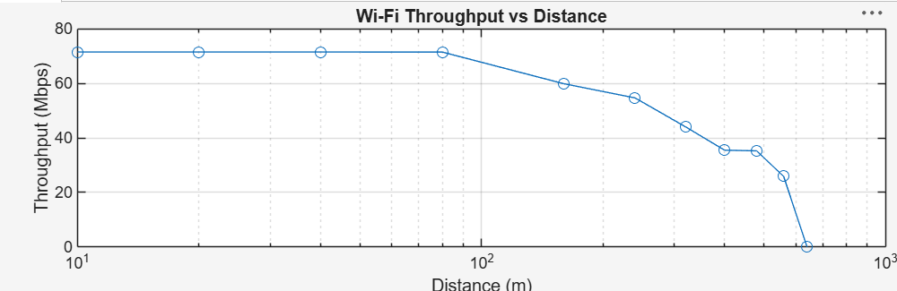

# Wi-Fi Performance Analysis in ns-3

802.11ac network simulations built in ns-3 and analyzed with Wireshark and MATLAB.
Course project for EECE5155 (Wireless Sensor Networks & IoT), Northeastern University.

**Authors:** Shashank Meghashyam, Riya Rawal

## Tasks
- **Task 1 – Ad-hoc network:** 5 nodes, random-walk mobility, UDP echo traffic.
- **Task 2 – Infrastructure mode:** 5 stations + 1 AP; beacons, association, and the effect of RTS/CTS on retries and delay.
- **Task 3 – Throughput vs. distance:** single AP–STA link with Friis path loss and Minstrel rate adaptation.

## Key results

- RTS/CTS eliminated data-frame retries but added 0.4–1.6 ms of delay under light traffic.
- Throughput stayed at ~71 Mbps up to 80 m, decreased with distance, and dropped to 0 at 640 m, matching Friis received-power predictions.

## Files
- task1-adhoc.cc, task2-infra.cc, task3-distance.cc – ns-3 simulation code
- ns3-wifi-performance-Report.pdf – full lab report with Wireshark analysis
- Task 3 Capture Files.rar – pcap captures from Task 3

## How to run
Copy the .cc files into your ns-3 scratch/ folder, then run:

    ./ns3 run task1-adhoc
    ./ns3 run 'task2-infra --rtsCts=true'
    ./ns3 run 'task3-distance --distance=320'

## Tools
ns-3, C++, Wireshark, MATLAB
